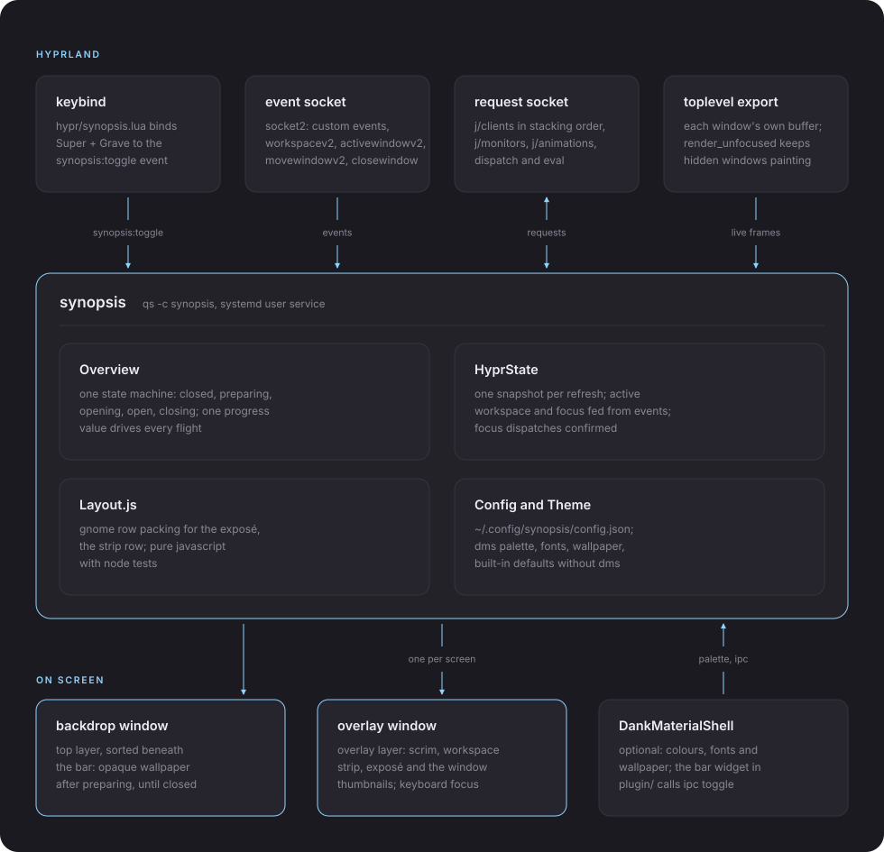

# architecture

how synopsis is put together. it is one quickshell process with an overlay and a backdrop per monitor, one state machine, and a thin layer of hyprland IPC underneath. the reasons behind this shape are in [research](research/), and the measurements behind the numbers are in the [tuning log](tuning.md).

## ⚙️ the process

synopsis runs as its own long-lived process, `qs -c synopsis`, separate from DankMaterialShell (DMS). its windows stay hidden until a hyprland event wakes them, so at rest it is one sleeping process.

- the shell lives in `shell/`. install is a symlink from `~/.config/quickshell/synopsis`, and saving a file hot-reloads it.
- `systemd/synopsis.service` is a user unit that restarts the shell a second after a crash. the bar is never affected.
- `hypr/synopsis.lua` is loaded with `io.open` and `load` rather than `require`, so hyprland does not autoreload it.
- `bin/synopsis` wraps `qs -c synopsis ipc call overview ...` for scripts.

it is a separate process on purpose. DMS plugins have no fullscreen surface, and a known quickshell crash with many live captures (#1123) should take down the overview, not the bar.

### the source tree

| path | what it holds |
|---|---|
| `shell/shell.qml` | the root, one overlay and backdrop per screen, the event listener and the ipc handler |
| `shell/Core/Overview.qml` | the state machine, models, actions, focus, drag and drop |
| `shell/Core/HyprState.qml` | hyprland IPC, dispatches, stacking order, live state |
| `shell/Core/Layout.js` | the exposé and strip layout |
| `shell/Core/Wallpaper.qml` | the wallpaper path, still, tile video and cover files |
| `shell/Core/Config.qml` | `~/.config/synopsis/config.json` with defaults |
| `shell/Core/Theme.qml` | design tokens, DMS sources and defaults |
| `shell/Ui/` | the windows and components, including `WallpaperVideo` (the tile player) |
| `shell/Scripts/wallpaper-proxy.sh` | builds the small clip the tiles play |
| `shell/Debug/FrameLog.qml` | frame timing for the journal |
| `plugin/` | the optional DMS bar widget |
| `tests/layout.test.js` | node tests for `Layout.js` |
| `tools/` | the simulator and the recording and measuring scripts |

## ⌨️ the trigger

the keybind calls `hl.dsp.event(...)`, which writes a `custom>>` line to hyprland's event socket. synopsis already listens there, so a keypress reaches it with no process spawn. the whole path takes about 4ms.

events look like `synopsis:<verb>[:<arg>[:<arg>]]`.

| event | what it does |
|---|---|
| `synopsis:toggle`, `open`, `close` | the overview itself |
| `synopsis:confirm` | Enter, close and land on the workspace shown |
| `synopsis:activate-workspace:<id>` | a tile click |
| `synopsis:activate-window:<address>` | a window click |
| `synopsis:move-window:<address>:<ws>` | move a window to a workspace |
| `synopsis:new-workspace` | the plus button |

the extra verbs let [the simulator](../tools/sim/README.md) take the same code paths a click does. the `overview` ipc handler is the scripted fallback and what the bar widget calls.

## 🔁 the state machine

one singleton, `Overview`, owns the state and everything else binds to it. nothing keeps its own copy of "open". a second copy is exactly what broke the DMS overview, where a click changed one copy and the window holding the keyboard never found out.

| state | what happens |
|---|---|
| `closed` | windows hidden, no captures, hidden windows at their rest rate |
| `preparing` | state refreshed, models built, captures started, every thumbnail sitting over its real window |
| `opening` | the flight runs, progress 0 to 1 |
| `open` | input is live and events keep everything current |
| `closing` | the flight runs back, or into a tile switch |

open and close can be interrupted at any point. a toggle while opening reverses the flight, a toggle while preparing cancels, and toggles never queue up. presses within 50ms of the last one are ignored, which absorbs key repeat. if opening ever hangs, a watchdog forces `open`.

### preparing and the open gate

the overview first appears with every thumbnail sitting exactly over its real window, so its first frame looks like the desktop. a thumbnail stays blank until its capture has a frame, and the flight waits up to 250ms for all of them. a single slow thumbnail shows a placeholder for at most 400ms.

if a window moves before the flight starts (usually a workspace keybind pressed right after the toggle), the layout is out of date. synopsis notices the event, hides the exposé and rebuilds it on the next refresh.

### the flight

one value, `Overview.progress`, drives everything. each thumbnail moves between its real spot and its layout spot based on that value. separate animations per item would re-run every binding each frame, which once dropped the DMS bar to 25fps, so there are none.

the flight is 260ms `OutCubic`. thumbnails use hyprland's own corner rounding and border colours, so nothing jumps when the overview opens. a clicked thumbnail flies home on top, so it is already raised when the overview disappears.

## 🖼️ the backdrop and the wallpaper cover

`BackdropWindow` paints the wallpaper on the top layer, just beneath the DMS bar, so the bar stays visible while everything else dims. it stays opaque until a close has fully finished. it used to go clear too early, and a slide still running showed the real windows twice.

the backdrop is its own surface, so its first frame can arrive one refresh after the overlay's. the flight waits for it, with a 100ms limit, and the thumbnails hold still until then.

### the cover

a live wallpaper that supports it can lift its own window to the top layer while the overview is open. the wallpaper then hides the real windows, synopsis paints no backdrop, and the open has nothing to wait for. the `synopsis-cover` layer rule keeps the lifted window beneath the bar. layer rules apply when a surface opens, so the rule takes effect the next time the wallpaper window opens.

the two sides talk through two files per monitor in `$XDG_RUNTIME_DIR`, both written atomically.

| file | written by | content |
|---|---|---|
| `eco-cover-<monitor>.json` | synopsis | `{cover, at, pid}`. `cover` asks for the top or background layer, `at` is the write time and doubles as a sequence number |
| `eco-cover-state-<monitor>.json` | the wallpaper | `{top, at, seq, pid}`. `top` is the layer it is now on, `seq` is the `at` it is answering |

- **detection.** the wallpaper counts only while its state file exists and its process is alive. synopsis checks at startup and on every open.
- **open.** synopsis asks for the cover just as the flight is about to start. the answer stands in for the backdrop's first frame, and it only counts if `seq` and `top` match the request.
- **fallback.** if no answer arrives within 70ms, that monitor shows the plain still for the rest of that open.
- **close.** after the flight lands, synopsis asks the wallpaper to drop back and keeps its own layer up until the answer arrives or 100ms pass. reopening during that wait just asks again.
- **safety.** synopsis clears any leftover request at startup, and the service deletes request files when it stops. the wallpaper ignores requests older than 10s, drops the cover if synopsis has died, and always drops it after 10 minutes.
- **fullscreen.** with a fullscreen window on the monitor, hyprland hides top layer surfaces, so the cover is hidden just like the backdrop.

`coverViaWallpaper` turns it off. with `frameLog` on, the journal shows each request, answer and fallback.

### video wallpapers in the tiles

with a video wallpaper the tiles play a small copy of the clip while the overview is open, rather than running a second full-size decoder.

- **the copy.** `shell/Scripts/wallpaper-proxy.sh` builds it in the background (1280px wide, 30fps, x264, low priority) and caches it in `~/.cache/synopsis/wallpaper/`, keyed on the clip's name, size and modification time. until it exists, or without ffmpeg and ffprobe, the tiles show the still.
- **the player.** `WallpaperVideo` only exists while the overview is open. it draws into one texture that every tile shares. it starts at the wallpaper's playhead (`$XDG_RUNTIME_DIR/eco-playhead-<monitor>.json`) aimed 60ms ahead, so tiles and desktop match.
- **switch.** `liveWallpaper` turns it off and keeps the still.

## 🎯 keyboard focus and the handoff

while a layer holds exclusive keyboard focus, hyprland refuses to focus any window. so a switch made with the overview open would move the workspace but leave focus behind. these rules came out of that.

- the overlay starts with no keyboard focus and only takes it once the backdrop has painted (or after 100ms). taking it earlier made the focused window's border flash.
- after that it drops to on-demand focus, never to none. going to none makes hyprland refocus the last window and jump back to the old workspace.
- focus changes are sent a moment later (20ms), then confirmed against hyprland's own event and retried every 60ms up to six times.
- every close decides what should have focus next. a tile click wins. otherwise the last focused window on the now active workspace gets it, which keeps a switch from an outside keybind.
- with a scratchpad open, a close sends no focus change, so the scratchpad survives.

Escape and Enter are handled by the overlay, so they are ignored until it has focus. the toggle is a hyprland bind and always works.

## 🔌 hyprland IPC

`HyprState` holds everything synopsis knows about the compositor.

- **reads.** requests go to hyprland's request socket. hyprland closes the connection after replying, so a reply ends on disconnect. every request is asynchronous.
- **one snapshot.** each refresh reads monitors, workspaces and clients and publishes them together. publishing them one by one rebuilt every model three times.
- **stacking order.** hyprland lists clients in its own drawing order, so the last one is on top. synopsis raises any window it focuses with `alter_zorder`, and draws tiled windows first, then floating ones in that order. the DMS overview used creation order instead, which put a raised window beneath newer ones.
- **live state.** the active workspace comes straight from events, not from a refresh. a refresh can never overwrite a newer event, and a switch starts its slide within a frame.
- **dispatch.** with the lua config, dispatches go out as `eval` chunks of `hl.dispatch(...)`. a silent move is `hl.dsp.window.move({ workspace = N, follow = false, window = ... })`.
- **config.** the hidden window frame rate is changed with `eval hl.config(...)`, which sets one value without a reload. it is lowered at the very end of a close, since an eval can take up to 230ms.

## 📸 capture and live thumbnails

each thumbnail is a `ScreencopyView` showing the window's own buffer, so no pixels are copied. what costs is how many there are and how often they update.

- **hidden windows.** hyprland only sends frame callbacks to the visible workspace, so a client like mpv freezes elsewhere. the `render_unfocused` rule keeps every window ticking at 1fps, and synopsis raises that to 60fps while open.
- **suspended apps.** some gtk4 apps (Resources, for one) pause themselves on hidden workspaces. no rule changes that, so their tiles freeze.
- **refresh rate.** the exposé and the current and hovered tiles are live. other tiles refresh 12 times a second, and tiles scrolled out of view skip it.
- **quickshell #1123.** many live views starting at once can crash quickshell, so they are started a few at a time. if it crashes anyway, only synopsis goes down and the unit restarts it.
- **nothing stays warm.** captures stop as soon as the overview hides.
- **keepalive.** a one-pixel item keeps animating while open, so captures keep updating even when nothing else moves.
- **screen sharing.** screenshots and recordings capture the overview.

## 📐 layout

`shell/Core/Layout.js` has no qml in it. it takes rectangles and an area and returns rectangles. the exposé is a port of gnome shell's window layout. it tries one row, then two, and so on, packs windows into rows by their vertical centre, scales them all by one factor (at most 0.95) and keeps the arrangement that wastes the least space. window shapes are always kept, and on an ultrawide the content does not stretch across the whole screen.

node tests cover a set of fixtures (one window, a dozen, a fullscreen window with a tiny one, extreme shapes, overlaps, zero size) on an ultrawide and a full HD area. they check there is no overlap, everything stays inside, shapes are kept and the result is the same every time.

## ↔️ workspace slides

switching workspaces while the overview is open slides the exposé. the old windows move out, the new ones move in, and the strip highlight glides to the new tile.

- **one row per window.** every row tracks its own start and end offset, so a new switch picks up from wherever each row actually is. rows leave toward the side their workspace sits on, so nothing ever reverses or shows twice.
- **fast switching.** when switches come faster than a slide lasts, each slide gets shorter (never under 140ms), and at most two workspaces are on screen at once.
- **distance.** windows travel just far enough to clear the screen, so the middle of a slide on an ultrawide still shows something.
- **hyprland's curve.** by default slides use hyprland's own workspace curve. spring settings are read from the last `hl.curve` in `hyprland.lua`, since hyprland does not report them. it was tuned on spring `gentle` (mass 1, stiffness 110, dampening 20), which settles in 911ms.

### tile clicks

a tile click switches workspace with hyprland's animation turned off behind the backdrop. once hyprland confirms (a millisecond or three later), the slide and the close flight start together on the same curve. the new windows slide in sideways at full size and land on the real windows. Escape during this close lets it finish, toggle reverses it, and a second tile click is ignored.

## 🗂️ the workspace strip

- **fixed tiles.** tiles are sized as if there were six, capped so seven and the plus button fit. they never shrink as you add more.
- **the plus button.** sits outside the scrolling row, so it is always visible. it adds an empty workspace tile without leaving the overview. unused ones are removed on close.
- **overflow.** from eight tiles the row scrolls with Shift and the wheel, a horizontal wheel, a touchpad or a thin bar that appears on hover. the edges fade when there is more to see, and the active tile is kept in view.
- **during a drag.** holding a window near either end of the row scrolls it.

## 🖐️ drag and drop

- **hit testing.** tiles register with `Overview`, and every pointer move checks the pointer against each tile's visible area. the grab point stays under the cursor.
- **shrink.** the thumbnail shrinks as it nears the strip, so the strip stays visible.
- **accept.** the pointer has to be inside a tile. a floating window lands at the matching spot on the target workspace, unless too little of it would stay on screen. a tiled window dropped outside every tile is rejected.
- **dispatch.** a floating window is moved, placed and raised in one `eval`, so there is no frame in between. the target tile shows a preview until hyprland confirms the move.
- **return.** a missed drop flies back in 450ms.
- **cancel.** if the overview closes or the row disappears mid-drag, the drag is cancelled and nothing is sent.

## 🎨 theming

everything visible reads from `shell/Core/Theme.qml`, which uses the same token names as DMS (`primary`, `surface`, `surfaceText`, `cornerRadius` and so on). no component holds its own colour, timing or font. the sources below are watched for changes.

| file | what it supplies |
|---|---|
| `~/.cache/DankMaterialShell/dms-colors.json` | the dark and light palettes |
| `~/.config/DankMaterialShell/settings.json` | fonts, corner radius, animation speed |
| `~/.local/state/DankMaterialShell/session.json` | light mode and the wallpaper path |
| `~/.cache/DankMaterialShell/palette-applied.stamp` | when to apply a new palette |

a new palette is read when it lands but only applied when the stamp changes, which a patched DMS bar writes on the frame it switches. that keeps synopsis changing colour together with the bar. without DMS every value has a default.

## 🪣 special workspaces

scratchpads do not show in the strip yet, but nothing assumes they never will. only one place filters them out (`showSpecialWorkspaces`), and everything is keyed on workspace id, so a scratchpad tile would be a new component, not a rewrite.

## 🔍 debug and measurement

- `SYNOPSIS_FRAMELOG=1` or `frameLog` logs frame times, state changes, slides, drags and drops to the journal. gaps between frames during a flight are the real sign of trouble.
- `synopsis stats` prints capture counts and the last open time.
- `tools/gpu-sample.sh` samples GPU load and `tools/framelog.py` reads the journal.
- `tools/record.sh` records a live bug for `tools/sim/analyze.py --live`.
